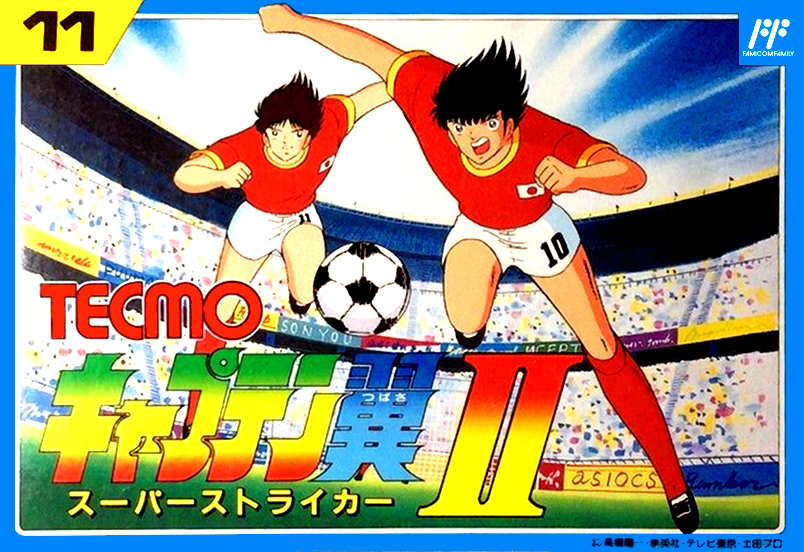

  

  
  
  
  
  
  

# Captain Tsubasa 2 Remake

An unofficial Godot reconstruction of the Turkish NES release. The current milestone rebuilds the cold-start opening and original music, then stops at the title menu with **KICK OFF** and **CONTINUE** visible. It does not enter either option.

The game runs from the Godot project without loading the supplied ROM or starting an emulator. Runtime resources extracted from the ROM are kept in the project and their source information is documented under **reference/rom_extract/**.

The poster above is the original promotional image supplied by the project owner and is stored at `assets/readme/captain-tsubasa-2-poster.jpg`. The same artwork supplies the desktop application icons; it is kept separate from the ROM-derived game visuals. Its source is [LaunchBox](https://images.launchbox-app.com/78127ee0-f18d-4a8d-87d1-eb8afdb3ca0a.jpg), and its rights remain with its respective owners.

## Table of Contents

1. [Features](#features)
2. [Current milestone](#current-milestone)
3. [Requirements](#requirements)
4. [Run locally](#run-locally)
5. [Controls](#controls)
6. [Project layout](#project-layout)
7. [Verification notes](#verification-notes)
8. [CI and releases](#ci-and-releases)
9. [Contributing](#contributing)
10. [License and original game content](#license-and-original-game-content)

## Features

- ROM-command-driven opening presentation, sprite animation, text timing, and sound triggers.
- Original CHR, palette, background, sprite, and audio-derived project resources.
- ROM-derived opening music with an offline Godot audio resource.
- Title handoff to the initial **KICK OFF** / **CONTINUE** menu.
- No ROM file or emulator dependency at runtime.

## Current milestone

The opening plays from a cold start and ends at the title menu. Cursor movement is available, but confirming a title option is outside this milestone. Match play, story selection, and continue flows are not implemented here.

The implementation follows decoded ROM behavior and project-owned data rather than replaying captured emulator frames. Known timing gaps are summarized in **GOAL.md**. Bulky local diagnostic captures are excluded from this repository and are not required by the running game.

## Requirements

- Godot 4.7.2
- Desktop keyboard or gamepad

## Run locally

Open this folder in Godot 4.7.2 and run the main scene. From a terminal with Godot available:

    godot --path . scenes/main.tscn

## Controls

- Up / Down: move the title cursor.
- Tab / controller Back: switch the title selection.
- Enter / controller Start: trigger the opening's Start handoff. The title options themselves remain unconfirmed in this milestone.

## Project layout

- **scenes/**: main scene, opening runtime, and title menu.
- **scripts/**: ROM-derived presenter, renderers, input, and audio code.
- **assets/opening/**: project-owned runtime audio and event data.
- **reference/rom_extract/**: source bytes, decoded records, and provenance for runtime resources.
- **reference/palettes/**: the documented external palette used for NES-color comparison.
- **docs/**: focused architecture and behavior notes.
- **tools/**: extraction and diagnostic utilities; these are not runtime dependencies.

## Verification notes

The project's latest same-input comparison reports a full match for the visible 256×224 NTSC crop across 4,693 opening frames. Raw 256×240 PPU comparisons preserve the overscan rows and can show a small y=0 difference. This does not establish physical 2C02 sub-frame timing.

The active soundtrack is generated from ROM-derived CPU/APU/DMC events and the pinned FCEUX audio filter implementation. Its PCM matches the recorded FCEUX filtered reference; that comparison is not a claim about analog NES output.

## CI and releases

Every branch push and pull request targeting **main** runs a clean Godot import and a short headless main-scene launch. Version tags use the release workflow, which checks the project, exports Linux x86_64, Windows x86_64, and macOS Universal desktop packages, and publishes those with source ZIP/TAR.GZ archives, a SHA-256 manifest, and a verified Sigstore signature bundle. Desktop packages include `THIRD_PARTY_NOTICES.txt` for required engine notices; this does not add engine branding to the game's menus. The macOS app has a valid built-in ad-hoc signature but is not notarized, so Gatekeeper may still require a one-time approval; a Developer ID signature and notarization are needed to avoid that prompt. The Windows executable is not Authenticode-signed and may show a SmartScreen unknown-publisher warning. The Linux archive preserves the executable permission. If the RELEASE_GPG_PRIVATE_KEY Actions secret is configured, the manifest also receives a detached GPG signature; RELEASE_GPG_PASSPHRASE is optional for an unencrypted key.

Sonar badges and quality gates are intentionally absent: Sonar's documented supported-language list does not include GDScript, so it would not analyze the game's main code.

## Contributing

See [CONTRIBUTING.md](CONTRIBUTING.md) for commit and pull request conventions. Bugs and proposals can use the repository issue forms.

## License and original game content

The project license is [Apache-2.0](LICENSE) for work that the project contributors are entitled to license. The original game's ROM, graphics, music, text, characters, and marks are not relicensed by this file. The ROM itself is not part of this repository.

The poster file is not covered by the Apache-2.0 license.
